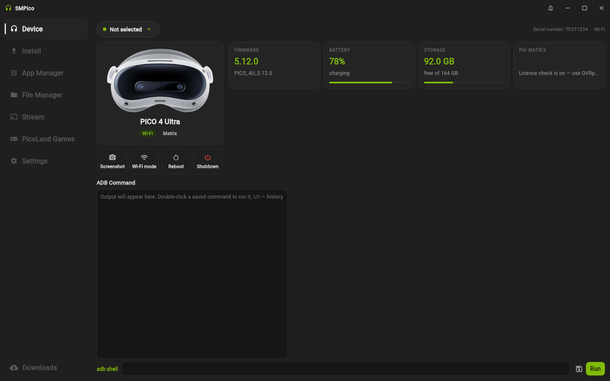

# SMPico

Desktop app for PICO VR headsets. Installs games and apps over adb, manages
the headset's packages and files, streams the view through scrcpy, and
downloads games from the PicoLand catalog.



Windows, macOS and Linux. Built with Flutter.

## Features

- **Device** — model, firmware, battery, storage; screenshot, Wi-Fi mode,
  reboot/shutdown and a raw adb console
- **Install** — drop an `.apk`, `.zip`, `.rar` or `.7z` (multi-volume
  works); Auto picks the install method, Manual exposes Repack / Direct /
  Overport with signing and package options
- **App Manager** — launch, uninstall, extract APKs, back up and restore
  save data, edit permissions
- **File Manager** — browse headset storage, drag-and-drop copy, find the
  heaviest files
- **Stream** — scrcpy with per-eye cropping, resolution, fps, bitrate,
  codec and recording
- **PicoLand** — the community game catalog with covers and genre filters.
  Downloads resume mid-file after restarts, run several at once
  (configurable) and can delete themselves after a successful install
- **Settings** — language (EN/RU/ZH), accent color, folders, catalog
  updates, download behavior, the MCP server, help and reset
- **MCP server** *(off by default)* — streamable-HTTP endpoint on
  `127.0.0.1` for AI agents: device status, app management, catalog search
  and downloads, installs, remote files, raw adb shell. Same code paths
  the UI uses

## Downloads

Prebuilt packages are on the
[releases page](https://github.com/justacalico/smpico/releases):

- Windows — x86_64 and ARM64 `.zip`
- Linux — x86_64 and ARM64 `.tar.gz` / `.zip`
- macOS — Apple Silicon `.dmg` / `.zip`

## Building

```
flutter pub get
flutter build linux      # or: windows / macos
```

External tools (adb, unrar, scrcpy, apktool, apksigner, overport-cli, JRE)
are expected under the tools folder; the app looks for them next to the
binary and in `C:\ProgramData\smpico\tools` / `~/.local/share/smpico/tools`.

## License

GNU AGPL v3 — see [LICENSE](LICENSE).
